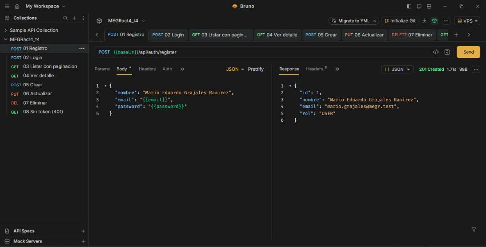
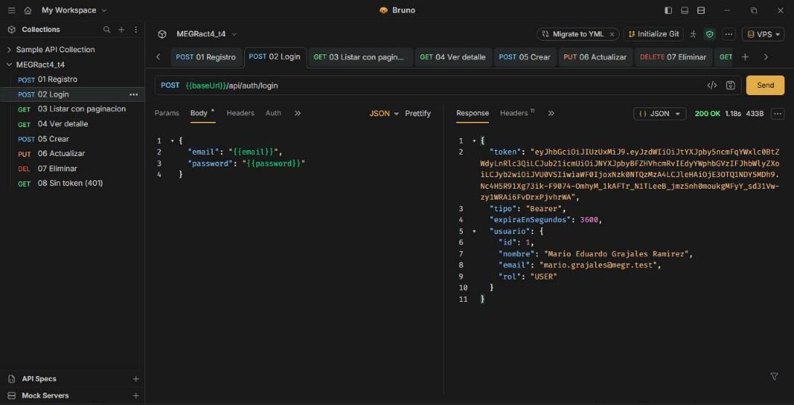
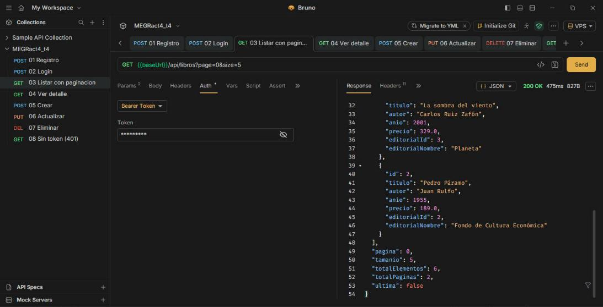
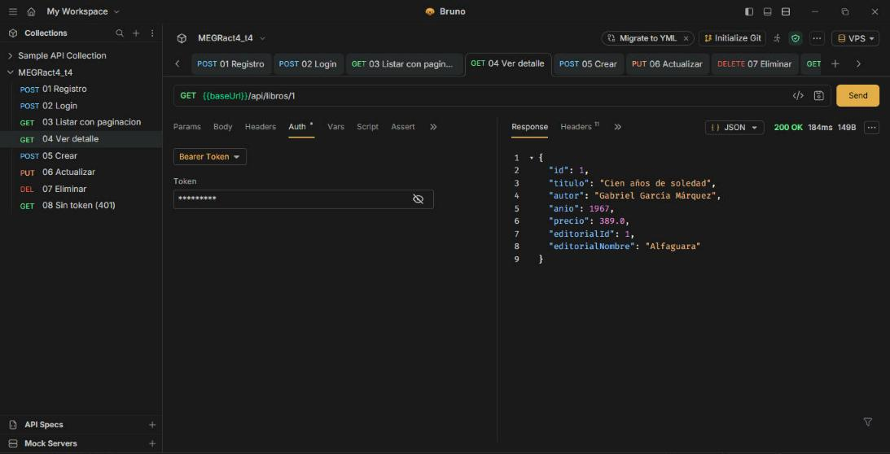
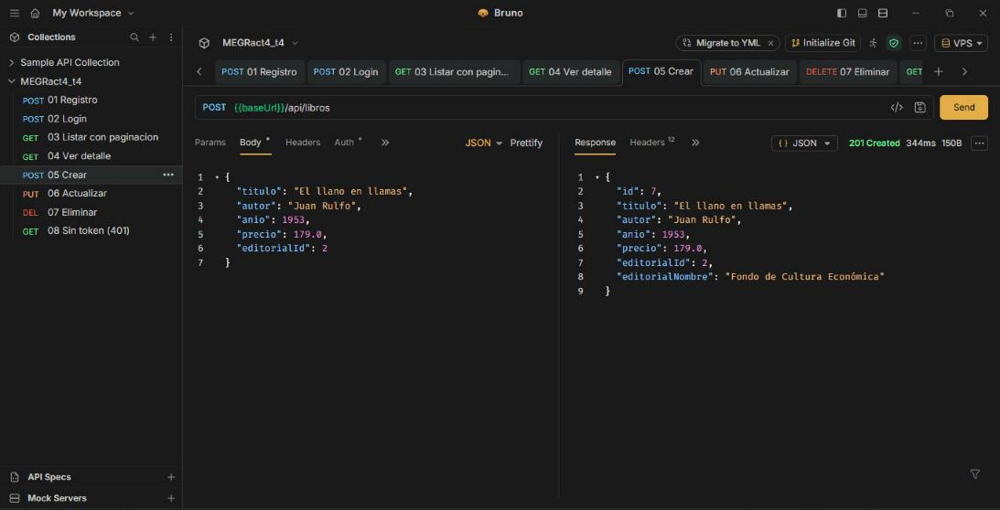
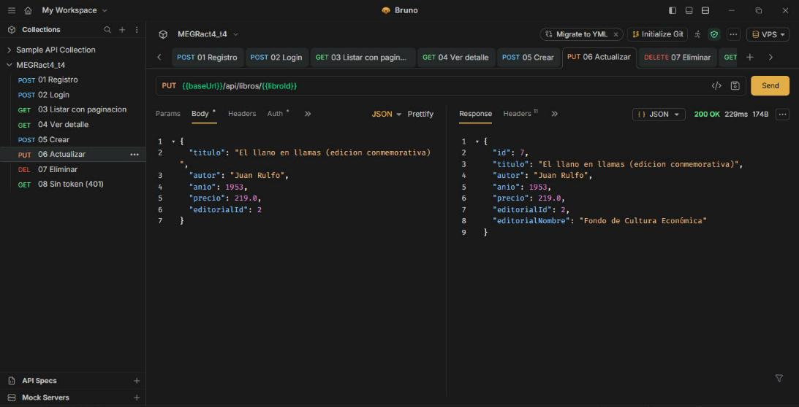
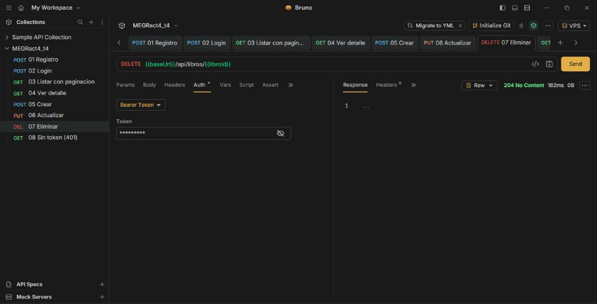
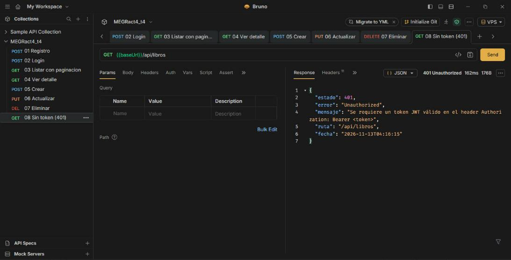

# MEGRact4_t4 — Actividad 4: API REST segura con Spring Security y JWT

**Autor:** Mario Eduardo Grajales Ramírez
**Tecnologías:** Java 17, Spring Boot 4.1.2, Spring Web, Spring Data JPA, Spring Security, JWT (jjwt 0.12.6), Bean Validation, MySQL
**Puerto:** 8087

API REST (solo JSON, sin vistas) con registro, login por token JWT y un CRUD de **libros** relacionados con su **editorial**. Todos los endpoints del CRUD están protegidos: sin un token válido responden **401 Unauthorized**.

## Arquitectura

```
src/main/java/com/example/demo
├── model/        Usuario, Editorial, Libro               (entidades JPA)
├── dto/          RegistroRequest, LoginRequest, AuthResponse, UsuarioResponse,
│                 LibroRequest, LibroResponse, EditorialResponse,
│                 PaginaResponse, ErrorResponse            (entrada/salida de la API)
├── repository/   UsuarioRepository, EditorialRepository, LibroRepository
├── service/      AuthService, LibroService                (lógica de negocio)
├── controller/   AuthController, LibroController          (@RestController)
├── security/     SecurityConfig, JwtTokenProvider, JwtAuthenticationFilter,
│                 UsuarioDetailsService, JsonAuthenticationEntryPoint
├── exception/    GlobalExceptionHandler y excepciones propias
└── config/       DatosIniciales                           (datos de ejemplo)
bruno/            colección de Bruno con las pruebas
```

## Flujo de seguridad

1. `POST /api/auth/register` crea el usuario; el password se guarda cifrado con **BCrypt**.
2. `POST /api/auth/login` comprueba las credenciales y devuelve un **JWT** firmado con HMAC-SHA256 (válido 1 hora).
3. El cliente envía el token en cada petición: `Authorization: Bearer <token>`.
4. `JwtAuthenticationFilter` valida la firma y la expiración y autentica al usuario en el `SecurityContext`.
5. Sin token, o con uno inválido o expirado, `SecurityFilterChain` responde **401** en JSON.

## Endpoints

| Método | Ruta | Acceso | Respuestas |
|---|---|---|---|
| POST | `/api/auth/register` | Público | 201, 400, 409 |
| POST | `/api/auth/login` | Público | 200, 400, 401 |
| GET | `/api/libros?page=0&size=5&sort=titulo,asc` | Bearer | 200, 401 |
| GET | `/api/libros/{id}` | Bearer | 200, 404, 401 |
| POST | `/api/libros` | Bearer | 201, 400, 404, 401 |
| PUT | `/api/libros/{id}` | Bearer | 200, 400, 404, 401 |
| DELETE | `/api/libros/{id}` | Bearer | 204, 404, 401 |
| GET | `/api/editoriales` | Bearer | 200, 401 |

Cuerpo de ejemplo para crear o actualizar:
```json
{ "titulo": "El llano en llamas", "autor": "Juan Rulfo", "anio": 1953, "precio": 179.0, "editorialId": 2 }
```

Las validaciones (`@NotBlank`, `@Email`, `@Size`, `@Min`, `@PositiveOrZero`, `@NotNull`) devuelven **400** con el detalle de cada campo. Las respuestas usan DTOs, por eso el password nunca aparece.

## Ejecución

```bash
./mvnw clean package -DskipTests
java -jar target/MEGRact4_t4.jar
```

Variables de entorno opcionales: `DB_URL`, `DB_USER`, `DB_PASSWORD` y `JWT_SECRET` (mínimo 32 caracteres).

## Colección de Bruno

Abrir la carpeta [`bruno/`](bruno) en Bruno (**Open Collection**) y elegir el entorno **Local** o **VPS**. El login guarda el token automáticamente en la variable `token`, y las peticiones protegidas lo envían como Bearer.

1. Registro · 2. Login · 3. Listar con paginación · 4. Ver detalle · 5. Crear · 6. Actualizar · 7. Eliminar · 8. Sin token (401)

## Capturas de pantalla

Pruebas ejecutadas en Bruno contra la API desplegada en el VPS (entorno **VPS**, `http://216.238.94.85:8087`).

### Registro de usuario


### Login con token JWT


### Listar con paginación (Bearer token)


### Ver detalle (Bearer token)


### Crear (Bearer token)


### Actualizar (Bearer token)


### Eliminar (Bearer token)


### Sin token: 401 Unauthorized

